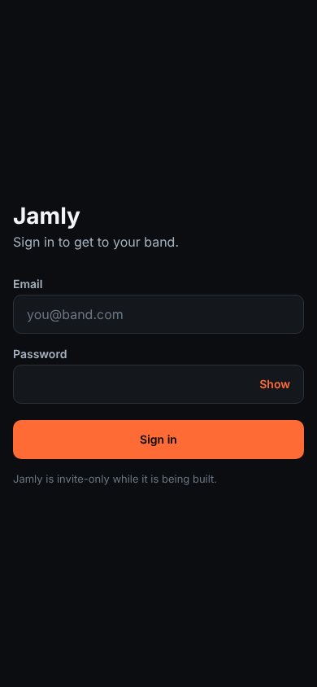

# Learn: seeing the product's screens from a cloud session

> What [Agents know the product's screens before proposing where things go](https://github.com/ferrarolabs/agent-kit/issues/87) added: `scripts/screens/capture.js`, and the rule in [the guide](../guides/capture-the-current-screens.md).

## The feature in one paragraph

An agent that drafts a UI issue now looks at the screen first. It builds the app for web, serves the build inside the cloud session, and takes a phone-sized screenshot of each route with Playwright. The script says which routes it really reached, and which ones an auth gate redirected. Proven on jamly `dev` at `35b6077`, 2026-11-02: the sign-in screen below was captured in a cloud session, and the four routes behind the gate came back `redirected`.



## How it is laid out

```text
scripts/screens/
├─ capture.js        the CLI: args → static server → Chromium → one PNG per route
└─ capture.test.js   the pure parts, on node:test
docs/guides/capture-the-current-screens.md   when and how agents use it
```

`capture.js` keeps the pure decisions in small exported functions, and the browser in `main`:

| Function | Decides |
|---|---|
| `parseArgs` | the flags; refuses a missing `--out`, `--routes`, or both `--serve` and `--base` |
| `fileNameFor` | `/band/create` → `band-create.png`, never a `/` in the name |
| `staticFileFor` | which file the server returns, or `null` for the single-page fallback |
| `signInFromEnv` | the sign-in settings, and the *names* of the variables missing |
| `landing` | reached or redirected |

## Concepts worth knowing

### 1. A static export plus a single-page fallback

`npx expo export --platform web` writes one `index.html` and a JS bundle. There is no `band/create.html`: Expo Router reads the URL in the browser and picks the screen. So the server answers every path it has no file for with `index.html`. That is the "single-page fallback".

```js
const file = staticFileFor(root, req.url) || index;
```

### 2. A server that can't leave its folder

The request path comes from the page, so the server treats it as untrusted. `/../secret` and its encoded form `/%2e%2e/secret` must not read outside the build. The path is decoded, normalised as an absolute path, then resolved under the root. If the result is outside the root, it falls back to `index.html`:

```js
const full = path.resolve(base, '.' + path.posix.normalize('/' + decoded));
if (full !== base && !full.startsWith(base + path.sep)) return null;
```

The test was seen failing with this guard removed (5 of 6 passed), and passing with it back.

### 3. Redirected is not reached

Behind an auth gate, `/band/create` quietly becomes the sign-in screen. A screenshot named `band-create.png` that shows the sign-in form would mislead whoever reads the issue. `landing` compares the path asked for with the path the page ended on, and the report says `redirected`:

```text
redirected  /band/create → /sign-in  …/band-create.png
```

### 4. Secrets by name only

The test account comes from environment variables, never from flag values, which end up in shell history and in the command log. A flag can only say *which* variable to read (`--email-env JAMLY_TEST_EMAIL`), so the script reuses what a project's environment already holds. `--email-env me@example.com` is refused: it isn't a variable name. The script prints only variable *names*: `sign-in skipped: missing JAMLY_TEST_PASSWORD`. A test checks that a value never shows up in that report.

### 5. Why test only the pure parts

Starting Chromium in CI for a docs repo is slow and flaky. The browser part is proven by a real run, pasted in the PR. The decisions that could quietly go wrong (file names, path escape, redirect detection, missing variables) are unit-tested.

## Decisions and alternatives

- **The script lives in `scripts/`, not in `template/`.** Like the deny-rule probe, it runs from a kit checkout against any project. And nothing goes into `template/` before it is proven on the pilot ([ADR 0014](../decisions/0014-kit-aligned-at-every-harness-merge.md)).
- **Rejected: `npx expo start --web`.** A dev server, slow to start, and it needs a watcher. A static export is one command and leaves nothing running.
- **Rejected: committing screenshots to the product repo.** They go stale. They belong in the issue or PR they illustrate.
- **Rejected: a sign-in flag (`--password`).** It would end up in the command log.
- **Rejected: fixed `CAPTURE_*` names only.** jamly's environment already holds the account as `JAMLY_TEST_EMAIL` and `JAMLY_TEST_PASSWORD` (ADR 0016). Asking for a second copy under new names means two places to rotate. `--email-env` and `--password-env` read the existing ones.

## What running it found

- jamly's web export builds in a cloud session in about a minute after `npm ci`.
- Without `EXPO_PUBLIC_SUPABASE_URL` and `EXPO_PUBLIC_SUPABASE_ANON_KEY` in the environment, every route except `/sign-in` redirects to sign-in. The sign-in step's default selectors matched jamly's form: a fill with fake values went through without a timeout.
- The run was in agent-kit's cloud environment, which has none of jamly's variables. jamly's own environment holds the test account (Elia, in the PR review). So the screens behind the gate are captured from a session on jamly's environment, with `--email-env JAMLY_TEST_EMAIL --password-env JAMLY_TEST_PASSWORD`.

## Where to look

- [scripts/screens/capture.js](../../scripts/screens/capture.js)
- [scripts/screens/capture.test.js](../../scripts/screens/capture.test.js)
- [docs/guides/capture-the-current-screens.md](../guides/capture-the-current-screens.md)
